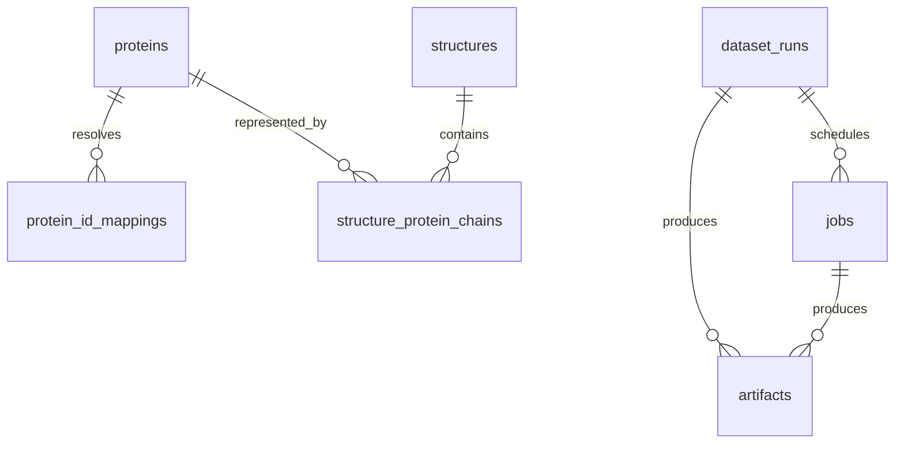

# PostgreSQL metadata schema (PP-12)

PostgreSQL owns relational metadata only. Protein structure files, Parquet datasets, model weights, and embeddings remain in object storage or their owning graph/vector systems.

## Entity relationship overview



## Tables and key rules

| Table | Purpose | Key constraints |
|---|---|---|
| `proteins` | Canonical project-owned protein record | Opaque immutable UUID primary key; accession is descriptive metadata only |
| `protein_id_mappings` | External source identifier history | Unique by source + source ID + source version; unresolved/ambiguous rows have no protein FK; deprecated may retain an optional successor |
| `structures` | Structure source metadata and object URI | Unique by source + source structure ID + source version |
| `structure_protein_chains` | Protein-to-chain association | Unique structure + chain; restrictive FKs preserve provenance |
| `dataset_runs` | Dataset execution/provenance | Status constrained to pending/running/completed/failed/cancelled |
| `jobs` | Processing job lifecycle | Status check, nonnegative retry count, optional unique idempotency key |
| `artifacts` | File metadata and storage reference | Unique URI, nonnegative size; checksum and algorithm are a paired application invariant |

## Identity and mapping semantics

`protein_id` is generated by the project as UUIDv4 and is never derived from UniProt or another provider identifier. A provider identifier is recorded in `protein_id_mappings` with its source namespace and source release/version. Mapping states:

- `resolved`: unique target; internal protein FK required.
- `merged`: old identifier resolves to a successor; internal protein FK required.
- `deprecated`: retired identifier; successor FK is optional.
- `unresolved` and `ambiguous`: no internal protein FK; never interpret as negative biological evidence.

The PP-10 Protein contract example was corrected to use an opaque UUID. The UniProt accession remains an external mapping, not the internal key.

## Lifecycle transitions

Dataset runs: `pending -> running -> completed|failed|cancelled`. Pending may also be cancelled. Terminal dataset states are immutable.

Jobs: `queued -> running -> succeeded|failed|cancelled`. Failed jobs may be explicitly re-queued for a retry; succeeded/cancelled jobs are terminal. The job idempotency key is unique when supplied.

All timestamps are timezone-aware UTC values. Error summaries are bounded metadata; raw logs and secrets belong outside these rows.

## Artifact URI convention

Use `s3://{bucket}/{prefix}/{dataset-or-job}/{artifact-name}` for MinIO/S3-compatible storage. The local PP-12 default bucket is `protein3d-artifacts` and prefix is `artifacts`. Milvus uses its own bucket and root path. Keep object bytes out of PostgreSQL.

## Migrations and local commands

```bash
cp .env.example .env
uv sync
uv run alembic upgrade head
uv run alembic downgrade base  # destructive to metadata rows; local/test only
uv run pytest -m unit
uv run pytest -m integration  # requires Docker for Testcontainers
```

Migrations are the only supported schema mutation path. Application startup does not call `metadata.create_all()`.
