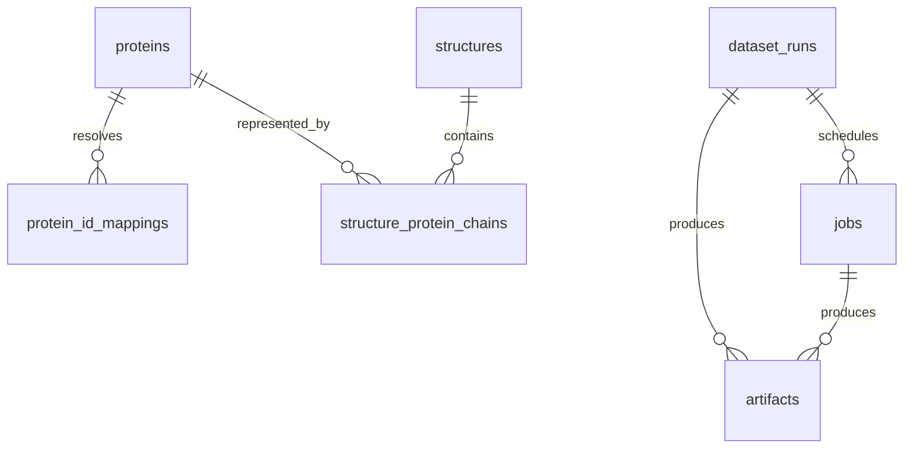

# PostgreSQL metadata schema (PP-12)

PostgreSQL owns relational metadata only. Protein structure files, Parquet datasets, model weights, and embeddings remain in object storage or their owning graph/vector systems.

## Entity relationship overview



## Tables and key rules

| Table | Purpose | Key constraints |
|---|---|---|
| `proteins` | Canonical project-owned protein record | Opaque immutable UUID primary key; accession is descriptive metadata only |
| `protein_id_mappings` | External source identifier history | Unique by source + source ID + source version; unresolved/ambiguous rows have no protein FK; deprecated may retain an optional successor |
| `structures` | Structure source metadata and object URI | Unique by source + source structure ID + source version |
| `structure_protein_chains` | Protein-to-chain association | Unique structure + chain; restrictive FKs preserve provenance |
| `dataset_runs` | Dataset execution/provenance | Status constrained to pending/running/completed/failed/cancelled |
| `jobs` | Processing job lifecycle | Status check, nonnegative retry count, optional unique idempotency key |
| `artifacts` | File metadata and storage reference | Unique URI, nonnegative size; checksum and algorithm are a paired application invariant |

## Identity and mapping semantics

`protein_id` is generated by the project as UUIDv4 and is never derived from UniProt or another provider identifier. A provider identifier is recorded in `protein_id_mappings` with its source namespace and source release/version. Mapping states:

- `resolved`: unique target; internal protein FK required.
- `merged`: old identifier resolves to a successor; internal protein FK required.
- `deprecated`: retired identifier; successor FK is optional.
- `unresolved` and `ambiguous`: no internal protein FK; never interpret as negative biological evidence.

The PP-10 Protein contract example was corrected to use an opaque UUID. The UniProt accession remains an external mapping, not the internal key.

## Lifecycle transitions

Dataset runs: `pending -> running -> completed|failed|cancelled`. Pending may also be cancelled. Terminal dataset states are immutable.

Jobs: `queued -> running -> succeeded|failed|cancelled`. Failed jobs may be explicitly re-queued for a retry; succeeded/cancelled jobs are terminal. The job idempotency key is unique when supplied.

All timestamps are timezone-aware UTC values. Error summaries are bounded metadata; raw logs and secrets belong outside these rows.

## Artifact URI convention

Use `s3://{bucket}/{prefix}/{dataset-or-job}/{artifact-name}` for MinIO/S3-compatible storage. The local PP-12 default bucket is `protein3d-artifacts` and prefix is `artifacts`. Milvus uses its own bucket and root path. Keep object bytes out of PostgreSQL.

## Migrations and local commands

```bash
cp .env.example .env
uv sync
uv run alembic upgrade head
uv run alembic downgrade base  # destructive to metadata rows; local/test only
uv run pytest -m unit
uv run pytest -m integration  # requires Docker for Testcontainers
```

Migrations are the only supported schema mutation path. Application startup does not call `metadata.create_all()`.

## Field-level data dictionary

All primary keys are project-generated UUIDs. Timestamp columns use timezone-aware PostgreSQL timestamps and are populated in UTC. JSONB columns hold bounded structured provenance/parameters, not raw logs or large scientific payloads.

### proteins

| Column | Type | Nullability | Meaning |
|---|---|---|---|
| protein_id | UUID | NOT NULL, PK | Immutable project-owned identity |
| canonical_accession | VARCHAR(64) | NULL | Convenience display/search accession; not the primary key |
| sequence | TEXT | NULL | Amino-acid sequence when available |
| organism_id | VARCHAR(64) | NULL | Taxonomy namespace + identifier |
| provenance | JSONB | NOT NULL, default `{}` | Source/version and derivation metadata |
| created_at / updated_at | TIMESTAMPTZ | NOT NULL | Record timestamps |

### protein_id_mappings

| Column | Type | Nullability | Meaning |
|---|---|---|---|
| mapping_id | UUID | NOT NULL, PK | Mapping record identity |
| protein_id | UUID | NULL, FK | Required for resolved/merged; optional for deprecated; absent for unresolved/ambiguous |
| source | VARCHAR(80) | NOT NULL | External namespace/provider, e.g. `uniprot` |
| source_id | VARCHAR(255) | NOT NULL | Identifier exactly as supplied by the source |
| source_version | VARCHAR(100) | NOT NULL, default `unspecified` | Provider release or mapping snapshot |
| mapping_status | VARCHAR(20) | NOT NULL | One of resolved/merged/deprecated/unresolved/ambiguous |
| mapping_evidence | TEXT | NULL | Short evidence/provenance note |
| created_at | TIMESTAMPTZ | NOT NULL | Mapping creation timestamp |

Unique key: `(source, source_id, source_version)`. Status/FK consistency is enforced by a CHECK constraint.

### structures and structure_protein_chains

| Table.column | Type | Nullability | Meaning |
|---|---|---|---|
| structures.structure_id | UUID | NOT NULL, PK | Internal structure metadata identity |
| structures.source / source_structure_id | VARCHAR(80) / VARCHAR(255) | NOT NULL | Provider namespace and external structure ID |
| structures.source_version | VARCHAR(100) | NULL | Provider release/version |
| structures.structure_format | VARCHAR(24) | NOT NULL | File format, e.g. CIF/PDB |
| structures.storage_uri | TEXT | NOT NULL | Object-store URI; bytes are not stored in PostgreSQL |
| structures.resolution_angstrom | FLOAT | NULL | Experimental/model quality metadata when available |
| structures.metadata_json | JSONB | NOT NULL, default `{}` | Additional bounded source metadata |
| structure_protein_chains.association_id | UUID | NOT NULL, PK | Association identity |
| structure_protein_chains.structure_id / protein_id | UUID | NOT NULL, FK | Referenced structure and canonical protein |
| structure_protein_chains.chain_id | VARCHAR(16) | NOT NULL | Chain identifier within the structure |
| structure_protein_chains.residue_start / residue_end | INTEGER | NULL | Optional residue interval |

Unique key: `(structure_id, chain_id)`; a structure can contain multiple chains associated with different proteins.

### dataset_runs and jobs

| Table.column | Type | Nullability | Meaning |
|---|---|---|---|
| dataset_runs.dataset_run_id | UUID | NOT NULL, PK | Dataset execution identity |
| dataset_runs.dataset_name / dataset_type | VARCHAR(120) / VARCHAR(80) | NOT NULL | Logical dataset identity and category |
| dataset_runs.source / source_version | VARCHAR(120) / VARCHAR(100) | NOT NULL / NULL | Source and optional release |
| dataset_runs.status | VARCHAR(20) | NOT NULL, default `pending` | Constrained dataset lifecycle state |
| dataset_runs.provenance | JSONB | NOT NULL, default `{}` | Input versions, parameters, and source traceability |
| dataset_runs.started_at / finished_at | TIMESTAMPTZ | NULL | Actual lifecycle timestamps |
| jobs.job_id | UUID | NOT NULL, PK | Processing job identity |
| jobs.dataset_run_id | UUID | NULL, FK | Parent dataset run when applicable |
| jobs.job_type / status | VARCHAR(100) / VARCHAR(20) | NOT NULL | Job kind and constrained lifecycle state |
| jobs.retry_count | INTEGER | NOT NULL, default `0` | Nonnegative retry counter |
| jobs.idempotency_key | VARCHAR(255) | NULL, UNIQUE | Optional key preventing duplicate logical jobs |
| jobs.parameters | JSONB | NOT NULL, default `{}` | Bounded job configuration |
| jobs.started_at / finished_at | TIMESTAMPTZ | NULL | Actual lifecycle timestamps |
| jobs.error_summary | TEXT | NULL | Concise failure summary; no raw logs/secrets |

### artifacts

| Column | Type | Nullability | Meaning |
|---|---|---|---|
| artifact_id | UUID | NOT NULL, PK | Artifact metadata identity |
| dataset_run_id / job_id | UUID | NULL, FK | Optional owning dataset/job |
| storage_backend | VARCHAR(40) | NOT NULL | Backend identifier, e.g. `s3` |
| uri | TEXT | NOT NULL, UNIQUE | Stable object-store URI |
| artifact_format / content_type | VARCHAR(40) / VARCHAR(120) | NOT NULL / NULL | Serialization format and MIME type |
| size_bytes | BIGINT | NULL, CHECK >= 0 | Object size when known |
| checksum / checksum_algorithm | VARCHAR(256) / VARCHAR(24) | NULL | Integrity metadata; both are supplied together by the domain layer |
| source_version | VARCHAR(100) | NULL | Source/producer version |
| created_at | TIMESTAMPTZ | NOT NULL | Metadata creation timestamp |

